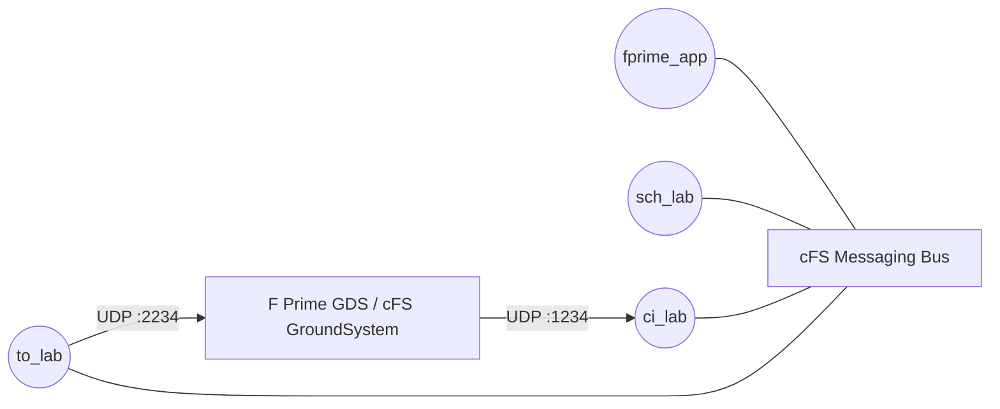

# fprime_cfs_reference: A cFS System Using F Prime cFS Applications

This repository contains a minimal cFS system that demonstrates the use of cFS applications built with F Prime. This demonstration includes the application:

1. `fprime_app`: A simple demonstration app showing how to construct cFS applications using F Prime

The system also includes the standard cFS lab apps:

- `sch_lab`: publishes the 1 Hz tick that drives the F Prime application's rate groups
- `ci_lab`: command ingest, receiving cFS command packets over UDP (port `1234`)
- `to_lab`: telemetry output, forwarding subscribed software bus telemetry over UDP (port `2234`)
- `raw_commander`: native cFS app that every 10 s (SCH_LAB wakeup `0x18A4`) sends command `0x18A0` (function code 1) with a random 1-32 byte payload to the F Prime app and checks the echo on telemetry `0x08A1`, reporting match / mismatch / timeout through EVS
- `raw_commanded`: native cFS app that answers the F Prime app's command `0x18A2` (function code 1) by echoing the payload on telemetry `0x08A3`, reporting receipt and rejected commands through EVS

`ci_lab` and `to_lab` are the system's only path between the software bus and the ground,
used by every ground system, one at a time (`to_lab` forwards to the single destination
last named in a TO_LAB enable-output command, which the `cfs-lab` plugin sends on connect
and after each quiet interval): the F Prime GDS (through the `cfs-lab` communication and
`cfs` framing plugins of the [fprime_cfs](https://github.com/fprime-community/fprime_cfs)
library), the [cFS GroundSystem](https://github.com/nasa/cFS-GroundSystem), and any other.
This path is plain UDP with no authentication or integrity protection: isolated lab and
bench networks only.
`to_lab` is subscribed to the F Prime downlink messages (telemetry `0x0801`, events
`0x0802`, files `0x0803`, data products `0x0805`, packetized telemetry `0x0820`; this
reference produces only events and packetized telemetry, the others are subscribed so a
project adding channel, file or data-product downlink needs no table change) in
`fprime_cfs_reference_defs/tables/cpu1_to_lab_sub.c`. F Prime events additionally reach cFS
EVS through `FPrimeCfs.EvsMirror`.



## Setup

Clone the repository and initialize the submodules:

```bash
git clone --recurse-submodules https://github.com/fprime-community/fprime_cfs_reference.git
```

Set up the python virtual environment and install the required dependencies:

```bash
python3 -m venv fprime-venv
source fprime-venv/bin/activate
pip install -r requirements.txt
```

You should be ready to prepare and build the reference system.

> [!TIP]
> Always activate the virtual environment using `source fprime-venv/bin/activate` before running any of the following commands.

## Building the Reference

This reference is built using the standard cFS build system. The first step is to prepare the build:

```bash
make SIMULATION=native prep
```

Once this build is prepared, build and install the reference system:

```bash
make
make install
```

## Running the Reference

> [!NOTE]
> The F Prime application's rate groups are driven by a 1 Hz tick message (command MID `0x1890`,
> APID `0x090`) published by the `sch_lab` scheduler app included in this system. The schedule is
> configured in `fprime_cfs_reference_defs/tables/cpu1_sch_lab_table.c`.

The build is installed in `build-artifacts/exe/cpu1/`. You can run the reference system using the following command:

```bash
cd build-artifacts/exe/cpu1/
./core-cpu1
```

## Raw cFS inter-application echo

`raw_commander` / `raw_commanded` and the F Prime `EchoResponder` / `EchoCommander` components exchange native
cFS command and telemetry packets whose payloads are opaque bytes (not F Prime serialized data) and never reach the
ground. Watch the EVS events on the `core-cpu1` console (`RAW_COMMANDER ... matched`, `RAW_COMMANDED: received echo
command`) and the F Prime events / counting channels (`FPrimeApp.echoResponder.*`, `FPrimeApp.echoCommander.*`) in
the GDS; `test/int/test_raw_cfs_echo.py` checks both. Warning events report mismatches, timeouts and rejected
commands.

## Running the F Prime GDS

The F Prime GDS commands through `ci_lab` and receives telemetry from `to_lab` using the
`cfs-lab` communication plugin and `cfs` framing plugin installed by the `fprime_cfs`
Python package (`./libs/fprime_cfs/python`, part of `requirements.txt`). The plugin sends
the `TO_LAB` enable-output command itself, so the GDS can be started before or after the
cFS system:

```bash
fprime-gds --communication-selection cfs-lab --framing-selection cfs \
    --dictionary ./build-artifacts/exe/Linux/fprime_app/dict/*Dictionary.json -n
```

Pass `--cfs-address`/`--telemetry-destination` when cFS runs on another host (the address
of the cFS host, and the address of the GDS host as seen from cFS, respectively).

## Running the cFS GroundSystem

The cFS GroundSystem can command and monitor the system directly through `ci_lab` and
`to_lab` using the `fprime-cfs` tooling from the
[fprime_cfs](https://github.com/fprime-community/fprime_cfs) library:

```bash
fprime-cfs --dictionary ./build-artifacts/exe/Linux/fprime_app/dict/*Dictionary.json \
    --ground-system-dir tools/cFS-GroundSystem \
    --deployment build-artifacts/exe/cpu1 --app build-artifacts/exe/cpu1/core-cpu1
```

Enjoy!
